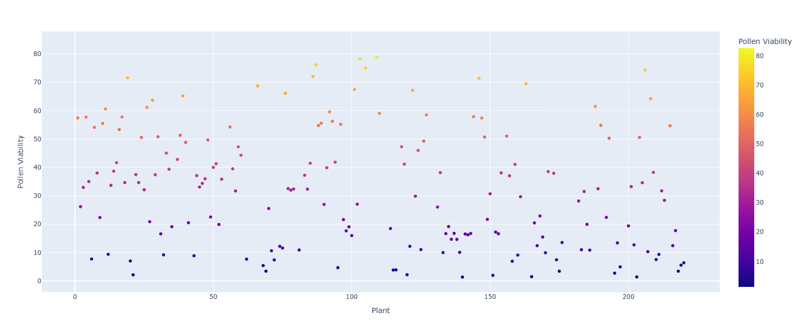
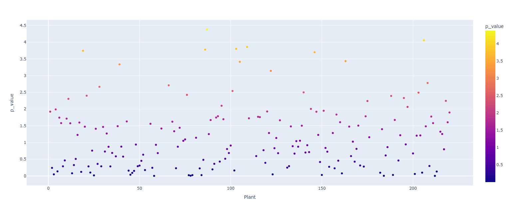
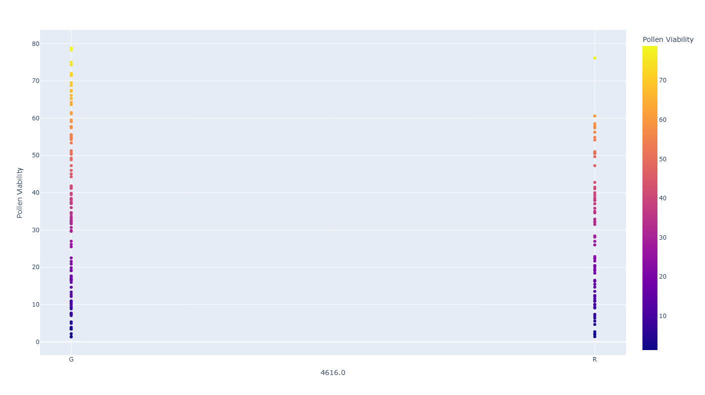
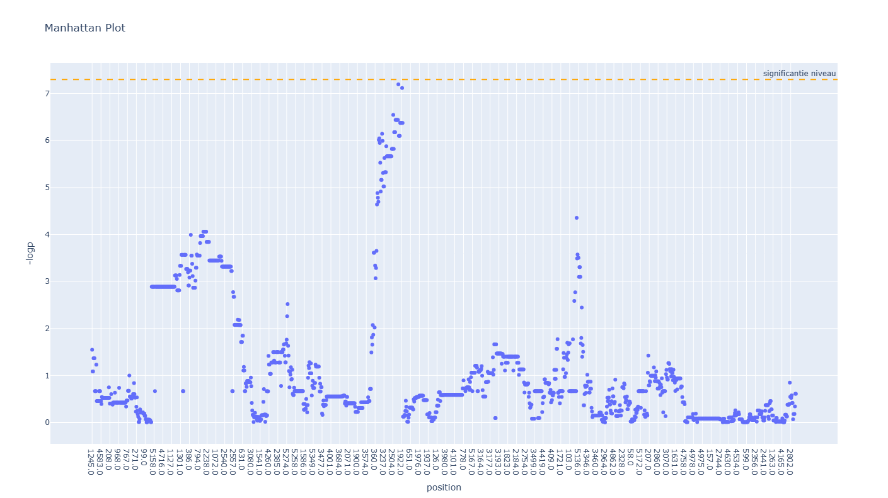

# GWAS

## tools
- vscode
- wsl (ubuntu)
- plotly
- pandas
- openpyxl
- numpy
- scipy

## data
De bestanden [Phenotype_data_PennxMB_population.xlsx](/data/Phenotype_data_PennxMB_population.xlsx) en [Sequencing_data_Inholland.xlsx](/data/Sequencing_data_Inholland.xlsx) horen bij elkaar.
### genotypering
In de data van de [genotypering](/data/Sequencing_data_Inholland.xlsx) is te zien dat:
- Er twee ouders zijn (Parent1 & Parent2), waarbij elk chromosoom is gesequenced (bijv. Parent1.1)
- Parent 1 is het ras N...., dit is een meer hitteresistent ras
- Parent 2 is het ras M...., dit is een commercieel ras
- In de data van de [fenotypering](data/Phenotype_data_PennxMB_population.xlsx) Parent1 correspondeerd met N.. en Parent2 met M..
- Wanneer er in een cel `failed` staat, dan is is er tijdens het sequencen een fout opgetreden, wanneer er 1 cel in een rij een failed melding heeft moet deze eruit gefilterd worden
- Bij sommige loci zijn bijde ouders heterozygoot en hebben ze de zelfde nucleotide voor de desbetreffende locus. Hieruit kan niet veel geconcludeerd worden, deze rijen diennen weg gefilterd te worden.
- F1 is een kruising tussen P1 en P2
- alle overige planten zijn kruisingen tussen F1 en P2

```
       P1         P2
        \         /
         \       /
          \     /
             F1
              |
              | 
         BACKCROSS
              |
          F1 × P2
              |
              | 
              |  
      Other plants
```

### fenotypering
In de data van de fenotypering zijn verschillende dingen te zien:
- de dag van de behandeling wanneer de monsters zijn genomen (1-4)
- de groeikamer (2 of 3)
- plant id (1-220, M1-M11 of N1-11)
- Pollen Viability (%), hoeveel goede pollen er flowcytometrisch zijn gemeten
- cellcount (int), Hoeveel cellen de flowcytometer heeft gemeten
- Duration (min:sec), hoelang de flowcytometer over de meting heeft gedaan
- seconds, De duration in secondes,
- Flowers (int), hoeveel bloemen er zijn gebruikt voor de meting
- week, in welke week de behandeling plaats heeft plaatsgevonden.
- pollen per flower, pollen per bloem (berekend met andere waarden)
- Als alle M metingen worden opgeteld zijn dit er 39 inplaats van de teverwachten 44 (11*4)
- Als de M meetingen worden gegroupeerd per meting ziet dit er als volgd uit:
```
Plant
M1     4
M10    4
M11    4
M2     2
M3     4
M4     3
M5     4
M6     3
M7     4
M8     3
M9     4
```
- er zijn een totaal van 646 metingen van de niet M of N planten dit is significant minder dan de 220 * 4 = 880 te verwachten metingen
- als de niet M of N planten worden gegroepeerd komt daar de volgende df uit:
```
     Plant  Pollen Viability
0        1         57.420775
1        2         26.173725
2        3         32.930675
3        4         57.698625
4        5         35.017475
..     ...               ...
176    216         12.425585
177    217         17.695058
178    218          3.417485
179    219          5.554000
180    220          6.384068
```
Hier is te zien dat 20 planten missen en 180*4 = 720. Dit is wederom meer dan de daadwerkelijke 646 metingen.

## code
De functie `get_average_per_plant()` accepteerd een dataframe en de naam van twee series(colom namen). Deze functie maakt vervolgens een dataframe met series 1 gegroupeerd (planten) en het gemiddelde van series 2

De functie `clean_phenotype_data()` accepteerd een dataframe (phenotype data) en haalt de colommen weg die geen nuttige informatie hebben.

De functie `filter_failed_homozygote()` accepteerd een dataframe (sequencing_data) en haalt de rijen weg waarbij alle loci van de ouders (Parent) heterozygoot zijn, maar ook als er maar 1 van de readings gefaald (failed) is.
De heterozygoot test is [hier](/data/heterozygote_test.csv) te vinden en de heterozygoot + failed test is [hier](/data/failed_test.csv) te vinden.

De functie `t_test_M()` accepteerd een dataframe (fenotype data) en voert vervolgens een t-test uit op deze dataset waarbij de M resultaten worden vergeleken met de niet M of N resultaten.
Dit wordt gedaan door eerst twee dataframes te maken, 1 voor planten met M in de naam en 1 voor planten zonder M of N in de naam. Hiervoor moet de plant colom eerst volledig naar strings worden overgezet. Vervolgens worden de planten gegroupeerd en er wordt een t-test uitgevoerd(niet de goede). Hierbij wordt de M groep per plant vergeleken. Als laatst wordt de plant colom weer een naar int overgezet. Ook wordt de dataframe op plant gesorteerd en alle indexen worden gereset.

De functie `create_manhattan_like_plot()` maakt een plot die iets weg moet hebben van een hanhattan plot (later vervangen door `create_manhattan_plot()`) hier enkele voorbeelden:

figuur 2: de pollen viability per plant

figuur 3: de p-waarde berekend met de functie `t_test_m()` per plant

figuur 4: de pollen viability per genotype op positie 4616.

De functie `merge_geno_and_phenotype()` voegd de feno- en genotype dataframes samen. Dit wordt gedaan door eerst een minimale versie van de fenotype tabel te maken. Het gemiddelde per plant wordt vervolgens berekend door de functie `get_average_per_plant()`. Een appart data frame wordt gecreërd voor de merker info. De genotype tabel wordt vervolgens omgezet (colom en rijën worden omgedraaid). De plant colommen van beide dataframes worden correct geformat, waarna ze worden gemerged.

De functie `group_by_location()` maakt een lijst met dictionaries met daarin de marker en en een dataframe met de daarbij behorende fenotypische/genetische informatie. Hierbij wordt eerst een lijst gemaakt met vallide merkers.

De functie `get_p_values()` maakt een dataframe met de marker en de p-waarde die berekend is met een ANOVA. Voordat de ANOVA wordt uitgevoerd, worden alle failed metingen weg gefilterd. Ook worden alle merkers met maar 1 genotype weggefilterd, hierop kan geen ANOVA worden uitgevoerd.

De functie `merge_pvalues_and_genotype_info()` voegt het dataframe van `get_p_values()` en het info dataframe van `merge_geno_and_phenotype()` samen.

De functie `prep_df_for_plotting()` zorgd ervoor dat alle informatie in het dataframe correct staat zodat deze kan worden gebruikt voor het plotten van de manhattan plot. Zo worden de p-waardes omgezet in -log(p)-waardes. Chromosoom nummers worden uit de `Chromosome` colom gehaald. Deze worden vervolgens gebruikt om de positie offset te bepalen

De functie `create_manhattan_plot()` zorgt ervoor dat de manhattan plot wordt gemaakt met behulp van plotly.

## plots

Figuur 5: 1e versie van de manhattanplot. Er zijn nog geen kleuren toegevoegd per chromosoom
.png)
Figuur 6: 2e versie van de manhattanplot. De chromosomen zijn nu gekleurd. Er is te zien dat er gebruik wordt gemaakt van de positie per chromosoom.
.png)
Figuur 7: 3e versie van de manhattanplot. er is nu gebruik gemaakt van de location offset, hierdoor zijn de markers gegroupeerd per chromosoom.
.png)
Figuur 8: 4e versie van de manhattanplot. inplaats van elke merker verwijderen waarbij ook maar 1 gefaalde meting is vastgesteld, zijn deze wel meegenomen in de berekeningen. De `failed` metingen hebben geen rol gespeeld in de berekeningen.

## overige info
```
total length: 5365
length after filtering: 3160
unique markers: 3160
loaded genotype info
loaded phenotype info
Transposed
merged geno and phenotype
grouped by location
skiped: 461 rows
got p-values
length after p-values 2699
length after final merge: 2699
final merge compleated
preped data for plotting
length after prep: 2699
```
